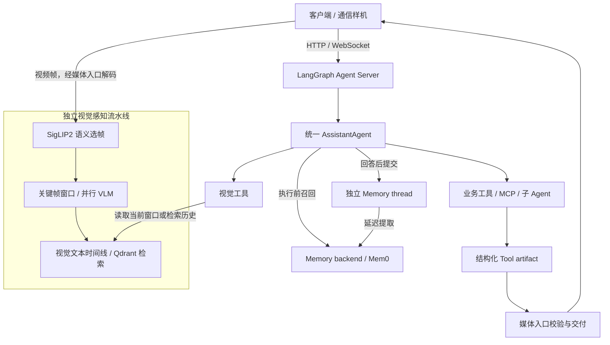

# assistant_agent

**面向实时通信场景的多模态助理 Agent。**

基于 LangGraph / Deep Agents 构建，将实时视觉理解、多步骤工具执行和长期记忆集成到统一 Agent 服务，通过 HTTP / WebSocket 对接客户端。

项目面向新通话场景的多模态样机预研，探索 Agent 如何在持续视频输入和多轮交互中理解场景、完成任务，并向客户端交付可使用的结果。本仓库聚焦 Agent 服务；通信终端、媒体传输基础设施和外部业务服务通过接口接入。

- **实时看懂**：持续处理摄像头画面，回答当前场景相关问题。
- **多模态记忆**：沉淀和召回文本和视觉记忆。
- **执行任务**：按需使用工具和子 Agent，完成查询、规划与文件操作。
- **交付结果**：通过结构化产物向客户端提供链接、卡片和生成物引用。

[演示](#演示) · [快速开始](#快速开始) · [架构与关键设计](#架构与关键设计) · [评测与优化](#评测与优化) · [文档导航](#文档导航)

## 演示

以下为演示材料的预留位置，录像与截图**待完善**。

| 场景 | 演示内容 | 材料 |
| --- | --- | --- |
| 实时视觉问答与历史找物 | 画面持续变化时询问当前场景，再检索此前出现的物品与时间线 | **待完善**：上传实际运行视频或连续截图，附示例问题与结果 |
| 多步骤任务与结果交付 | 展示一个购物或旅行查询任务，从用户请求、工具调用到最终链接或卡片 | **待完善**：上传端到端演示，标注使用的模型与外部服务 |
| 记忆与连续对话 | 展示跨会话记忆召回，以及回答后独立执行的记忆提取任务 | **待完善**：上传脱敏对话与后台任务截图 |

## 核心能力

| 能力 | 实现概览 |
| --- | --- |
| 多步骤任务 | 在统一 Agent 循环中使用工具、任务规划和子 Agent；复用 Deep Agents 原生能力 |
| 工具与 MCP | 标准工具调用、按需激活 Tool Profile、MCP 接入与可配置的人工审批 |
| 实时视觉 | SigLIP2 语义选帧、关键帧窗口并行 VLM 推理、按本轮目标窗口读取视觉文本 |
| 视觉记忆 |  会话内短期视觉记忆，

| 长期记忆与上下文 | Mem0 记忆召回、独立后台提取、动态 Prompt 与原生历史压缩 |
| 服务化与观测 | Agent Server 管理 thread / run / checkpoint，提供流式交互与 LangSmith 原生 tracing |

真实视觉、记忆和外部工具需要分别配置对应模型或服务；默认 mock 模式用于离线开发验证。

## 快速开始

### 1. 安装最小开发环境

以下命令面向 Linux / WSL，建议使用 Python 3.12。激活虚拟环境后，在仓库根目录执行：

```bash
git clone https://github.com/max-star-rgb/assistant_agent.git
cd assistant_agent
python -m pip install -e '.[agent-server-dev]'
python scripts/setup_local.py check
```

已有本地开发环境可继续使用 `hello_agent`。`setup_local.py check` 隔离真实凭据与用户数据，检查 mock 配置、MCP 模板和三张原生图装配；成功时输出 `PASS`。它不启动 Server，也不验证真实模型效果。

### 2. 启动 mock 服务

```bash
export MULTIMODAL_AGENT_PROVIDER_MODE=mock
export MEMORY_BACKEND=disabled
export MULTIMODAL_AGENT_MCP_ENABLED=0
export LANGSMITH_TRACING=false
python scripts/run_server.py --no-env-file --no-reload
```

服务默认监听 `http://127.0.0.1:8089`。`--no-env-file` 跳过本地 `.env`；若该端口已有服务，请复用已有实例，并确认其运行模式。

在另一个终端激活同一环境，进入仓库后发起请求：

```bash
python scripts/agent_cli.py --server http://127.0.0.1:8089 "你好"
# 或进入交互模式
python scripts/agent_cli.py --interactive
```

客户端打印服务返回的回复。此流程用于检查请求与响应链路；mock 回复不代表真实规划、视觉理解或记忆效果。

### 3. 配置真实能力

参考 [环境变量模板](.env.example)，在本机未跟踪的配置中显式设置 `MULTIMODAL_AGENT_PROVIDER_MODE=real` 与所需 Provider。真实模式下缺失配置不会静默回退到 mock。

| 体验范围 | 需要准备 | 说明 |
| --- | --- | --- |
| 真实对话与工具 | 主模型配置、对应业务 API 或 MCP 服务 | [工具与 MCP](docs/tool-calling-architecture.md) |
| 长期记忆 | Mem0 服务及 backend 配置 | [记忆架构](docs/memory-service-architecture.md) |
| 实时视觉与历史检索 | 视频输入端、VLM、SigLIP2 图文模型与 CUDA 环境；历史检索另需 BGE 和 Qdrant | [视觉架构](docs/visual-perception-architecture.md) |
| 媒体客户端联调 | 兼容媒体协议的客户端或模拟器 | [媒体协议](docs/media-agent-service-websocket.md)、[脚本入口](scripts/README.md) |

**待完善**：补充从全新环境到真实视觉演示的完整安装录像、硬件配置与验收记录。密钥、真实用户数据和原始媒体不要提交到仓库。

## 架构与关键设计



Agent Server 负责会话和执行生命周期；Deep Agents 提供规划、子 Agent、文件操作、上下文压缩与人工审批。项目重点处理以下场景问题：

| 问题 | 设计 | 详细说明 |
| --- | --- | --- |
| 工具数量增长导致模型请求携带大量 schema | 使用 Tool Profile 按需暴露已注册的工具组，模型选择调用，受信配置约束工具边界 | [工具架构](docs/tool-calling-architecture.md) |
| 视频持续输入，VLM 推理可能落后于画面 | SigLIP2 优先处理最新待分析帧；最多五个关键帧成窗，多窗口并行推理，用户提问时提前关闭未满窗口 | [视觉流水线](docs/visual-perception-architecture.md) |
| 连续对话中重复提取记忆 | 本轮召回结果冻结；回答后向独立 Memory thread 提交延迟 30 分钟的提取任务，由原生 rollback 策略处理冲突任务 | [记忆生命周期](docs/memory-service-architecture.md) |
| 模型最终回答可能遗漏业务链接或产物 | 工具在 artifact 中提供结构化交付内容，由媒体入口校验、追加和渲染所需引用 | [产物交付协议](docs/media-agent-service-websocket.md) |

## 评测与优化

使用 LangSmith 原生 tracing 观察 Agent、LLM 与工具执行；后台视觉窗口独立记录 trace，并通过 thread 与来源标识关联。当前仓库保留原生 Graph evaluation target，尚无完整可运行的行为质量评测 runner。

以下结果栏留待补齐实验材料。历史实验应标注对应 commit、模型和数据集，不将其视为当前版本的复测成绩。

| 优化项 | 对照方式 | 结果与证据 |
| --- | --- | --- |
| 工具 schema 开销 | 固定工具集合、模型与请求集，对比全量暴露和按需暴露的 schema tokens | **待完善**：样本数、统计口径、优化前后结果与实验记录 |
| 视觉输入开销 | 固定视频和基线选帧策略，统计送入 VLM 的帧数、tokens 与响应延迟 | **待完善**：视频条件、帧数变化、质量检查与硬件配置 |
| Agent 任务完成率 | 固定任务集，从结果、轨迹和单步行为评估，记录人工或模型评分标准 | **待完善**：数据集说明、评测器、版本对照与通过率 |
| 错误定位案例 | 从一次失败 trace 定位问题，展示修复和复测 | **待完善**：脱敏 trace 截图或链接、原因分析与复测结果 |

观测与真实评测边界见 [可观测性说明](docs/observability-harness.md)；开发验证见 [测试规则](tests/README.md)。

## 当前边界

- 当前默认采用本地 `langgraph dev` 运行方式，状态保存在 `.langgraph_api/`；快速开始不需要 PostgreSQL。
- 本地文件与 Shell 使用运行服务的 OS 权限；人工审批不等于沙箱隔离，多租户部署需要独立的执行隔离方案。
- `visual_memory_search` 只检索当前视频会话内的历史。跨会话长期视觉记忆属于独立外部服务，本仓库负责 Agent 侧接口集成。
- 真实能力依赖已配置的 Provider、模型资产和外部服务；mock 检查不替代真实效果评测。

## 文档导航

- [文档总览](docs/README.md)：按主题查阅当前设计与接口说明。
- [Agent Server](docs/agent-server-architecture.md)、[Agent 运行与流式架构](docs/runtime-event-stream-architecture.md)。
- [工具与 MCP](docs/tool-calling-architecture.md)、[上下文管理](docs/context_engineering_status.md)。
- [长期记忆](docs/memory-service-architecture.md)、[实时视觉与视觉记忆](docs/visual-perception-architecture.md)。
- [媒体接入协议](docs/media-agent-service-websocket.md)、[可观测性](docs/observability-harness.md)。
- [脚本入口](scripts/README.md)、[开发测试](tests/README.md)。

本页提供项目概览与体验入口；配置、接口和算法细节以各专项文档为准。
